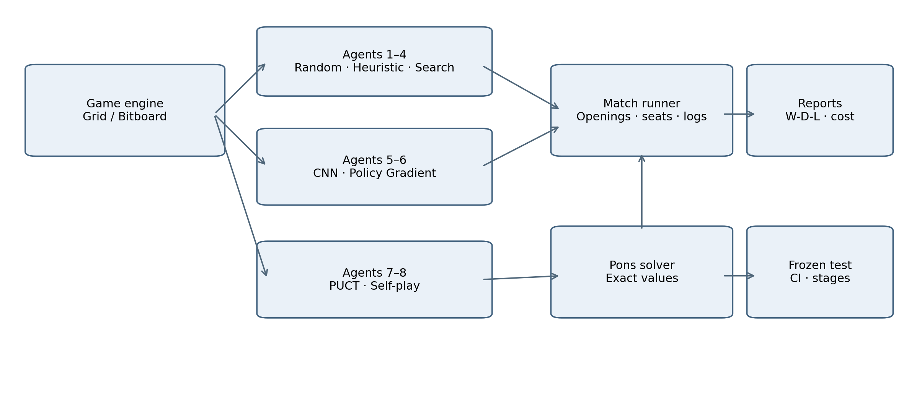
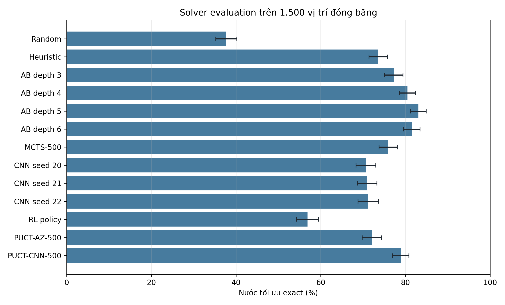
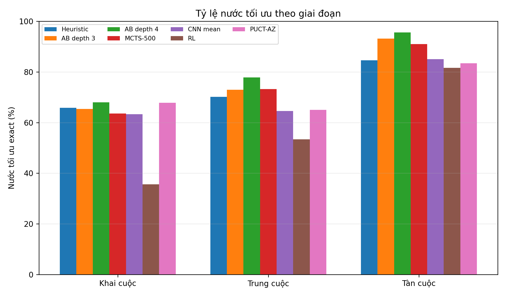
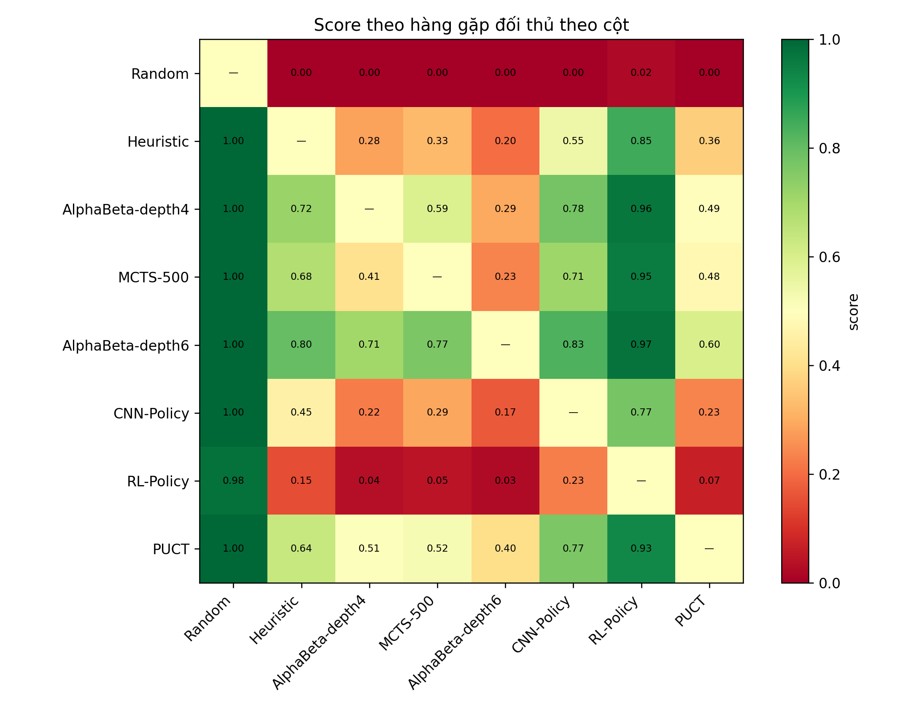

# Xây dựng và đánh giá Game AI đa cấp độ: Connect Four 7×6

**Báo cáo đề tài cuối kỳ – Trí tuệ nhân tạo nâng cao**
Nhóm: [CẦN BỔ SUNG: tên nhóm/mã nhóm]
Thành viên: [CẦN BỔ SUNG: họ tên, mã sinh viên, tỷ lệ đóng góp]
Giảng viên: [CẦN BỔ SUNG: họ tên giảng viên]
Ngày chốt dữ liệu: 23/11/2026

## Tóm tắt

Đề tài xây dựng hệ thống Connect Four 7×6 gồm các tác tử từ Random, Heuristic và tìm kiếm đối kháng đến MCTS, CNN policy/value, policy-gradient và self-play theo hướng AlphaZero. Hệ thống có hai engine lưới/bitboard, giao diện tác tử, bộ điều phối giải đấu và adapter gọi solver Pons để chấm vị trí chính xác. Trên tập test đóng băng 1.500 vị trí, AlphaBeta độ sâu 4 chọn nước tối ưu exact ở 80.5% (CI bootstrap theo cụm 95% [78.5; 82.4]%); ba seed CNN đạt trung bình 70.9% (độ lệch chuẩn giữa seed 0.3 điểm phần trăm). PUCT-CNN cấp 7 đạt 78.9%, còn PUCT-AZ cấp 8 đạt 72.1%. Round-robin ghép cặp cho thấy một số matchup như AlphaBeta-4 với MCTS-500 chưa phân biệt được theo score do CI chứa 0,5. CNN chưa đạt cổng đã đặt so với AlphaBeta-3; RL chỉ được huấn luyện đấu Random; Phase C v2 có hai run local; warm-start suy giảm trên validation, còn mức tăng của scratch chưa phân biệt được thống kê. Phase C v2 và đánh giá round-robin cuối đã chạy local; các ablation mở rộng vẫn chưa thực hiện.

**Từ khóa:** Connect Four; Alpha-Beta; MCTS; CNN; reinforcement learning; self-play; PUCT; solver.

## Mục lục

1. [Giới thiệu](#1-giới-thiệu) · 2. [Cơ sở lý thuyết](#2-cơ-sở-lý-thuyết-và-công-trình-liên-quan) · 3. [Phương pháp](#3-phương-pháp-và-thiết-kế-hệ-thống) · 4. [Kết quả](#4-thực-nghiệm-kết-quả-và-thảo-luận) · 5. [Kết luận](#5-kết-luận-và-hướng-phát-triển)

## Danh mục hình và bảng

Hình 1 kiến trúc hệ thống; Hình 2 nước tối ưu exact; Hình 3 theo giai đoạn; Hình 4 round-robin. Bảng 1 kết quả solver; Bảng 2 hiệu ghép cặp; Bảng 3 matchup; Bảng 4 value head; Bảng 5 thành phần cấp 7–8. Bảng RSS ở mục 4.5 là phép đo tài nguyên.

## Từ viết tắt

| Thuật ngữ | Diễn giải |
|---|---|
| AB | Alpha-Beta |
| CNN | Convolutional Neural Network |
| MCTS | Monte Carlo Tree Search |
| PUCT | UCT có policy prior |
| RL | Reinforcement Learning |
| WDL | Win/Draw/Loss; ở solver là giữ nguyên kết cục lý thuyết |
| CI | Khoảng tin cậy |

# 1. Giới thiệu

Connect Four là trò chơi hai người trên bàn 7 cột × 6 hàng. Mỗi lượt thả một quân vào cột; quân rơi xuống ô trống thấp nhất. Bốn quân liên tiếp theo ngang, dọc hoặc chéo tạo chiến thắng; bàn đầy mà không có chuỗi bốn là hòa. Đây là trò chơi thông tin đầy đủ, tất định, tổng bằng không và luân phiên lượt. Tromp ghi nhận khoảng 4,53 nghìn tỷ trạng thái hợp lệ; Allis chứng minh người đi trước thắng về lý thuyết trên bàn chuẩn nếu chơi tối ưu và khai cuộc ở cột giữa [1, 2]. Kết quả lý thuyết không đồng nghĩa các agent trong dự án tự chứng minh được chiến lược thắng.

Mục tiêu là xây dựng thang tác tử có độ phức tạp tăng dần, so sánh chất lượng nước đi, kết quả đối đầu và chi phí suy luận. Phạm vi chỉ gồm Connect Four 7×6. Câu hỏi nghiên cứu: (RQ1) các tác tử khác nhau thế nào theo solver và đối đầu; (RQ2) pruning/order ảnh hưởng chi phí ra sao; (RQ3) CNN có đạt giáo viên AlphaBeta-3 không; (RQ4) PUCT thêm gì cho policy; (RQ5) quy mô self-play/RL đã chạy có cho bằng chứng cải thiện; (RQ6) các kiểm soát đánh giá xử lý được sai lệch nào.

# 2. Cơ sở lý thuyết và công trình liên quan

## 2.1 Tìm kiếm đối kháng

Minimax giả định mỗi bên chọn hành động tối ưu theo mục tiêu đối nghịch. Alpha-Beta cắt nhánh không thể ảnh hưởng quyết định bằng các cận alpha/beta; lợi ích phụ thuộc thứ tự duyệt nước. Iterative deepening tìm lần lượt độ sâu tăng dần để duy trì phương án tốt nhất khi có giới hạn thời gian. Độ sâu cố định không tương đương ngân sách thời gian giữa các phương pháp.

## 2.2 MCTS và UCT

MCTS gồm chọn nút, mở rộng, mô phỏng và lan truyền kết quả. UCT cân bằng khai thác nhánh có giá trị cao với khám phá nhánh ít thăm [3]. Thang thưởng và góc nhìn giá trị phải nhất quán khi đổi lượt. MCTS trong dự án dùng rollout ngẫu nhiên nên nhạy theo seed và số simulation.

## 2.3 Policy/value CNN, RL và self-play

Bàn cờ được mã hóa thành hai mặt phẳng nhị phân: quân người đến lượt và quân đối thủ. CNN xuất policy trên bảy cột và value WDL. Học có giám sát bắt chước nhãn chuyên gia, do đó có thể thừa hưởng giới hạn của nguồn nhãn. Policy-gradient tối ưu policy theo phần thưởng episode; entropy khuyến khích khám phá. PUCT đưa policy prior vào tìm kiếm. AlphaGo/AlphaZero gốc dùng pipeline lớn hơn đáng kể; hai cấp tương ứng trong dự án chỉ là inspired, không phải tái hiện đầy đủ [4, 5].

## 2.4 Solver

Pons Connect Four Solver là chương trình C++ ngoài, gọi qua adapter Python và dùng làm nguồn điểm minimax; không phải đối thủ trong bảng xếp hạng. Mã nguồn phân phối theo AGPL-3.0 [6]. Kết quả agent được gọi là sức mạnh thực nghiệm; chỉ solver cung cấp đáp án exact cho vị trí.

# 3. Phương pháp và thiết kế hệ thống

## 3.1 Mô hình game và engine

State gồm bàn cờ, người đi, kết cục; action là cột hợp lệ. Transition đặt quân theo trọng lực, kiểm tra thắng/hòa và đổi lượt khi ván chưa kết thúc. Engine grid dễ kiểm tra; engine bitboard dùng bit để kiểm tra nhanh. Test parity đối chiếu diễn tiến giữa hai biểu diễn, cùng test nước sai, thắng, hòa và terminal.

## 3.2 Kiến trúc

*Hình 1. Kiến trúc hệ thống và luồng đánh giá.*

Agent tương tác với engine qua giao diện chung. Bộ điều phối quản lý lượt, openings, ghế và log. Pons được gọi riêng để chấm vị trí. Pipeline Colab tạo checkpoint và manifest; ingest local kiểm tra gói trước khi dùng. Mọi phép đo thời gian agent lấy trên máy local; Colab chỉ là môi trường huấn luyện.

## 3.3 Tám cấp tác tử

| Cấp | Phương pháp và hiện trạng |
|---|---|
| 1 | Random: chọn nước hợp lệ ngẫu nhiên, baseline. |
| 2 | Heuristic: luật chiến thuật và điểm cửa sổ bốn ô. |
| 3 | Alpha-Beta: minimax, pruning, ordering và iterative deepening ở cấu hình giới hạn thời gian. |
| 4 | MCTS-UCT với rollout ngẫu nhiên và ngân sách mô phỏng. |
| 5 | CNN supervised: ba seed từ nhãn solver; policy dùng khi chơi thuần, value được kiểm tra và dùng tại PUCT. |
| 6 | Policy-gradient 10.000 episode, chỉ đấu Random khi huấn luyện. |
| 7 | AlphaGo-inspired: policy prior + value leaf trong PUCT; đánh giá 500 simulations. Chưa có vòng RL policy đầy đủ như AlphaGo. |
| 8 | AlphaZero-inspired: self-play PUCT, Dirichlet, temperature, replay, policy/value update, resume; Phase C v2 có hai run local 40 vòng, một warm-start và một scratch. Self-play chưa cải thiện rõ trên validation. |

Tactical filter thắng ngay/chặn ngay có thể đóng góp đáng kể cho agent mạng. Kết quả cần được hiểu là hiệu năng của toàn cấu hình; tập kết quả chính chưa có bảng đối xứng có/không filter cho mọi agent.

## 3.4 Dữ liệu và huấn luyện

Ba run CNN dùng bộ nhãn solver v2: batch 64, tối đa 30 epoch, learning rate 0,001, value loss weight 0,5 và mirror augmentation. Chia train/validation theo ván nguồn; manifest ghi không trùng frozen test. Mỗi epoch xấp xỉ 21 batch; tổng log là 609/630 bước tùy early stopping. Môi trường là Tesla T4, Python 3.13.16, PyTorch 2.5.1+cu124; seed 20261120–20261122.

RL policy-gradient chạy 10,000 episode với Random, entropy weight 0.01. AZ chạy 100 iterations × 32 ván, 16 ván song song, 100 simulations/nước, 200 update steps/iteration, batch 128, replay cap 100,000, khởi tạo từ CNN seed 20261121. Manifest ghi 3,200 self-play games, 20,000 update steps và 1 lần resume. Chỉ lưu checkpoint cuối, không có snapshot iteration để tái tạo learning curve độc lập.

## 3.5 Thiết kế đánh giá

Frozen solver test gồm 1.500 vị trí, 500 mỗi giai đoạn: ply 7–10, 11–24, 25–41. SHA256 `3d8f9c747889d44821d8fd2ebe338570f59fef67f7e8961dd05153ef82d43b01`; solver commit `d6ba50d8aaf2308c769d9bf2abd42d90f34baf41`. Metric chính là tỷ lệ nước tối ưu exact và tỷ lệ giữ WDL. CI 95% dùng cluster bootstrap theo ván nguồn.

Round-robin có 8 agent, 100 ván mỗi cặp, 50 opening ghép cặp, đổi ghế. Trong 56 opening thử, bộ lọc giữ 50 và loại 6. Score = (thắng + 0,5 × hòa)/số ván; CI bootstrap theo opening ghép cặp. Đây là đấu theo cấu hình cố định, không phải cùng ngân sách thời gian. Benchmark 0,5 s/nước được báo riêng.

## 3.6 Bẫy đánh giá và xử lý

| Vấn đề | Xử lý và giới hạn |
|---|---|
| Ván lặp do agent tất định | Dùng chung opening, đổi ghế, ghi số opening hiệu dụng. |
| Thống kê hai bên bị gộp | JSON cuối lưu metric riêng từng agent; log cũ không so sánh trực tiếp. |
| Góc nhìn/thang điểm MCTS | Có test terminal/perspective; kết quả lấy từ bản đã sửa. |
| Khai cuộc có thắng tức thì | Lọc và ghi số lượng bị loại. |
| Rò rỉ test | Manifest các run CNN/RL/AZ ghi overlap 0; thử nghiệm đời sau có overlap được loại khỏi báo cáo. |
| Chọn ngưỡng hậu nghiệm | Dùng CRITERIA; phân tích sau được ghi nhãn thăm dò. |
| Phụ thuộc giữa vị trí | Bootstrap theo ván nguồn hoặc opening ghép cặp. |

# 4. Thực nghiệm, kết quả và thảo luận

## 4.1 Môi trường

Mã đánh giá ghi commit `5423c266894ee910d1b833d95aefe23a85f41613`; solver commit ở mục 3.5. Huấn luyện Colab ghi Tesla T4, 2 CPU cores, khoảng 12,7 GiB RAM, CUDA 12.4 và PyTorch 2.5.1+cu124. Thời gian suy luận đo local, không dùng runtime Colab làm so sánh agent.

## 4.2 Đánh giá solver

Hình 2 và Bảng 1 tóm tắt mức khớp nước tối ưu exact và giữ WDL. CNN mỗi seed được để riêng; không lấy CI của một seed làm CI của trung bình ba seed.

*Hình 2. Tỷ lệ chọn nước tối ưu exact và khoảng tin cậy bootstrap theo cụm.*

**Bảng 1. Kết quả solver trên tập test đóng băng.**
| Agent | N | Exact | CI 95% | Giữ WDL | CI 95% |
|---|---|---|---|---|---|
| Random | 1500 | 37.7% | [35.2; 40.2]% | 70.5% | [68.0; 72.9]% |
| Heuristic | 1500 | 73.5% | [71.4; 75.7]% | 88.3% | [86.6; 89.9]% |
| AB-3 | 1500 | 77.2% | [75.0; 79.4]% | 90.5% | [89.0; 92.0]% |
| AB-4 | 1500 | 80.5% | [78.5; 82.4]% | 91.7% | [90.3; 93.2]% |
| AB-5 | 1500 | 83.1% | [81.2; 84.9]% | 93.3% | [92.0; 94.5]% |
| AB-6 | 1500 | 81.5% | [79.5; 83.4]% | 91.5% | [90.0; 92.8]% |
| MCTS-500 | 1500 | 75.9% | [73.7; 78.1]% | 91.1% | [89.7; 92.6]% |
| CNN 20 | 1500 | 70.7% | [68.3; 72.9]% | 87.8% | [86.1; 89.4]% |
| CNN 21 | 1500 | 70.9% | [68.6; 73.2]% | 88.0% | [86.4; 89.6]% |
| CNN 22 | 1500 | 71.2% | [68.8; 73.6]% | 89.1% | [87.5; 90.7]% |
| RL policy | 1500 | 56.9% | [54.3; 59.4]% | 79.7% | [77.7; 81.6]% |
| PUCT-AZ-500 | 1500 | 72.1% | [69.7; 74.3]% | 91.7% | [90.1; 93.1]% |
| PUCT-CNN-500 | 1500 | 78.9% | [76.9; 80.8]% | 92.7% | [91.3; 94.0]% |

AlphaBeta-4 đạt 80.5% exact (CI [78.5; 82.4]%). AlphaBeta-5 cao hơn trên mẫu này, trong khi depth 6 thấp hơn depth 5; không suy rộng xu hướng này ngoài vị trí đã lấy mẫu. MCTS-500 đạt 76.3% trong lượt solver tương ứng. Ba CNN đạt 70.7%–71.2% exact, thấp hơn AlphaBeta-3 (77.2%). Bảng ghép cặp dưới đây cho thấy CI của (CNN − AB3) đều nằm dưới 0; vì vậy cả ba seed không qua cổng tối thiểu đã đặt. PUCT-CNN cấp 7 và PUCT-AZ cấp 8 là hai checkpoint khác nhau.

**Bảng 2. Hiệu ghép cặp của từng seed CNN so với AlphaBeta-3.**
| Seed CNN | Hiệu exact CNN − AB3, CI 95% | Diễn giải |
|---|---|---|
| 20261120 | [-9.1; -4.0] percentage points | Cận trên < 0 |
| 20261121 | [-8.8; -3.7] percentage points | Cận trên < 0 |
| 20261122 | [-8.6; -3.4] percentage points | Cận trên < 0 |

## 4.3 Kết quả theo giai đoạn

*Hình 3. Tỷ lệ chọn nước tối ưu exact theo giai đoạn.*

CNN trung bình đạt 63.3% ở khai cuộc và 85.0% ở tàn cuộc. Mức thấp ở đầu ván phù hợp với chẩn đoán rằng lỗi không chỉ là bỏ lỡ fork đơn lẻ. Các vị trí phụ thuộc ván nguồn; CI dùng cluster bootstrap.

## 4.4 Đối đầu trực tiếp

*Hình 4. Score của agent theo hàng khi gặp đối thủ theo cột.*

**Bảng 3. Các matchup round-robin được thảo luận.**
| Cặp | W-D-L | Score | CI 95% theo opening | Diễn giải |
|---|---|---|---|---|
| AlphaBeta-depth4 – MCTS-500 | 56-6-38 | 0.590 | [0.520; 0.665] | score > 0,5 |
| AlphaBeta-depth4 – PUCT | 45-9-46 | 0.495 | [0.405; 0.585] | Chưa phân biệt được với 0,5 |
| CNN-Policy – Heuristic | 40-11-49 | 0.455 | [0.370; 0.535] | Chưa phân biệt được với 0,5 |
| AlphaBeta-depth4 – AlphaBeta-depth6 | 25-9-66 | 0.295 | [0.220; 0.375] | score < 0,5 |
| CNN-Policy – PUCT | 16-15-69 | 0.235 | [0.165; 0.305] | score < 0,5 |
| RL-Policy – Random | 98-0-2 | 0.980 | [0.950; 1.000] | score > 0,5 |

AB4–MCTS-500 score là 0.590 (CI [0.52, 0.665]); AB4–PUCT cũng có CI chứa 0,5. Chưa phân biệt được hai cặp này. CNN–Heuristic có score 0.455 và CI chứa 0,5. RL policy thua đa số ván trước Random; reward lúc huấn luyện không thay phép đánh giá độc lập.

## 4.5 Ngân sách thời gian và ablation

Benchmark riêng AB-time-0,5s và MCTS-time-0,5s gồm 100 ván/50 opening: AlphaBeta score 0.435, CI paired-opening [0.345; 0.525], nên chưa phân biệt với 0,5. AB trung bình 0.272 s/nước, MCTS 0.476 s/nước. Đây là cấu hình riêng, không nhập vào round-robin cố định.

Ablation AlphaBeta qua ba seed, mỗi cấu hình chỉ 10 ván/seed, cho trung bình 367 node/nước với pruning+ordering so với 1794 khi tắt pruning, tức giảm 4.9 lần theo số node. Cỡ mẫu thấp nên đây là bằng chứng về chi phí tìm kiếm, không đủ để khẳng định sức chơi tốt hơn. Quét số simulation của MCTS cũng được xem là thăm dò.

Đo RSS local dưới đây lấy từ một ván cho mỗi tiến trình, sampling interval 100 ms; đây là đỉnh quan sát được, không phải giới hạn bộ nhớ cực đại. VRAM huấn luyện Colab được báo riêng từ manifest khi có, không dùng để so sánh agent.

| Agent | Peak RSS (MiB) | RSS tăng so với nền (MiB) |
|---|---|---|
| AlphaBeta-depth4 | 24.6 | 0.01 |
| MCTS-500 | 25.4 | 1.26 |
| CNN-Policy | 487.1 | 0.00 |
| PUCT-500 | 491.8 | 8.74 |

## 4.6 Chẩn đoán lỗi và value head

Trong 194 ván thua CNN được phân tích, 181 có ít nhất một nước dưới exact-optimal; 145 có nước đầu tiên làm giảm WDL, 13 không có lỗi exact; 14 lỗi đầu giảm WDL được phân loại fork hai ply và 131 là lỗi sâu/định vị. Có 97 ván đã ở thế thua cưỡng bức sau opening. Đây là thống kê hậu nghiệm trên ván thua được log, không đại diện toàn bộ ván.

**Bảng 4. Độ chính xác và sai số value head theo giai đoạn.**
| Giai đoạn | N | Accuracy WDL | Baseline đa số | CI 95% cluster | MSE |
|---|---|---|---|---|---|
| Tổng thể | 1500 | 53.5% | 52.1% | [50.6; 56.5]% | 0.720 |
| Khai cuộc | 500 | 59.2% | 52.4% | [54.9; 63.5]% | 0.549 |
| Trung cuộc | 500 | 55.6% | 56.4% | [50.9; 60.4]% | 0.743 |
| Tàn cuộc | 500 | 45.8% | 47.4% | [40.8; 50.8]% | 0.869 |

Trên toàn tập, CI accuracy [50.6; 56.5]% chứa baseline 52.1%; do đó chưa có bằng chứng value head vượt baseline. MSE được báo riêng, không quy đổi thành sức chơi.

## 4.7 Thảo luận và đe dọa hợp lệ

Solver exact và thắng thua đối kháng trả lời hai câu hỏi khác nhau. Tỷ lệ nước tối ưu phản ánh độ khớp quyết định trên tập test; score phản ánh đối đầu trên opening được chọn. CNN thuần nhanh hơn tìm kiếm nhưng còn khoảng cách với AB3. PUCT-CNN có exact cao hơn CNN thuần trong các file hiện có, song thiếu đối chứng cùng checkpoint policy-only có CI paired tương ứng để quy kết nhân quả. Phase C v2 có learning curve validation hai nhánh: warm giảm và scratch chưa cải thiện có ý nghĩa; RL chỉ học đấu Random. Kết quả self-play chưa chứng minh cải thiện phương pháp.

Giới hạn gồm một game, 1.500 vị trí solver, 50 opening hiệu dụng trong round-robin, phụ thuộc giữa các vị trí cùng ván, đóng góp của tactical filter, số seed hạn chế cho RL/AZ và tài nguyên Colab biến động. Pons dùng như thước đo ngoài, không phải agent dự thi.

## 4.8 Phase C v2: self-play PUCT

Hai run local hoàn tất 40 vòng, 400 simulations/nước, 32 ván và 200 cập nhật mỗi vòng, 16 ván song song, batch 128. Warm-start được khởi tạo từ CNN v3; scratch từ trọng số ngẫu nhiên. Checkpoint được chọn theo validation: warm iteration 0, scratch iteration 40. Mỗi nhánh có một seed nên kết luận về phương pháp học còn thăm dò.

Đường cong dưới dùng tỷ lệ nước tối ưu exact của PUCT có safety filter. CI bootstrap theo cụm ván nguồn; hiệu là ghép cặp so với iteration 0 của cùng run.

| Run | Iteration | Exact | CI 95% | Delta vs 0, pp (CI) |
|---|---|---|---|---|
| Warm | 0 | 89.53% | [88.6; 90.4]% | — |
| Warm | 5 | 85.84% | [84.8; 86.9]% | -3.70 pp [-4.61; -2.79] |
| Warm | 10 | 85.03% | [84.0; 86.1]% | -4.50 pp [-5.42; -3.60] |
| Warm | 15 | 85.39% | [84.3; 86.4]% | -4.14 pp [-5.06; -3.23] |
| Warm | 20 | 85.70% | [84.6; 86.7]% | -3.83 pp [-4.76; -2.90] |
| Warm | 25 | 85.19% | [84.1; 86.2]% | -4.34 pp [-5.26; -3.45] |
| Warm | 30 | 85.37% | [84.3; 86.4]% | -4.16 pp [-5.11; -3.23] |
| Warm | 35 | 85.08% | [84.0; 86.1]% | -4.45 pp [-5.38; -3.50] |
| Warm | 40 | 85.90% | [84.9; 86.9]% | -3.63 pp [-4.57; -2.71] |
| Scratch | 0 | 81.48% | [80.3; 82.6]% | — |
| Scratch | 5 | 80.32% | [79.2; 81.5]% | -1.16 pp [-2.28; +0.00] |
| Scratch | 10 | 82.21% | [81.1; 83.3]% | +0.73 pp [-0.44; +1.90] |
| Scratch | 15 | 81.52% | [80.4; 82.7]% | +0.04 pp [-1.16; +1.22] |
| Scratch | 20 | 81.77% | [80.6; 82.9]% | +0.29 pp [-0.85; +1.47] |
| Scratch | 25 | 81.70% | [80.5; 82.8]% | +0.22 pp [-0.92; +1.37] |
| Scratch | 30 | 82.25% | [81.1; 83.4]% | +0.78 pp [-0.37; +1.93] |
| Scratch | 35 | 81.94% | [80.8; 83.1]% | +0.47 pp [-0.68; +1.63] |
| Scratch | 40 | 82.48% | [81.3; 83.6]% | +1.00 pp [-0.16; +2.14] |

Self-play làm giảm exact ở nhánh warm; nhánh scratch tăng 1,00 điểm phần trăm ở iteration 40 nhưng CI ghép cặp chứa 0. Trên frozen test 1.500 vị trí, các cấu hình được chọn đạt:

| Agent | n | Exact | CI 95% | WDL | CI 95% |
|---|---|---|---|---|---|
| CNN v3 policy + filter | 1500 | 76.7% | [74.5; 78.9]% | 91.0% | [89.5; 92.4]% |
| PUCT-400 warm, iter 0 + filter | 1500 | 82.1% | [80.1; 84.0]% | 94.0% | [92.7; 95.2]% |
| PUCT-400 scratch, iter 40 + filter | 1500 | 76.8% | [74.7; 79.0]% | 91.9% | [90.5; 93.2]% |

Warm iteration 0 so với AlphaBeta depth 3 có exact +4,93 pp (CI ghép cặp [2.66; 7.21] pp) và WDL +3,47 pp (CI [1.99; 4.95] pp). Scratch chưa phân biệt được với depth 3.

Round-robin mới gồm tám agent, 100 ván/cặp, 50 opening chung đã qua fair filter, seed 20261123; CI bootstrap theo paired opening.

| Agent A | Agent B | W-D-L A | Score A | CI 95% |
|---|---|---|---|---|
| Random | Heuristic | 0-0-100 | 0.000 | [0.000; 0.000] |
| Random | AlphaBeta-depth4 | 0-0-100 | 0.000 | [0.000; 0.000] |
| Random | MCTS-500 | 0-0-100 | 0.000 | [0.000; 0.000] |
| Random | AlphaBeta-depth6 | 0-0-100 | 0.000 | [0.000; 0.000] |
| Random | CNN-Policy | 0-0-100 | 0.000 | [0.000; 0.000] |
| Random | RL-Policy | 1-0-99 | 0.010 | [0.000; 0.030] |
| Random | PUCT | 0-0-100 | 0.000 | [0.000; 0.000] |
| Heuristic | AlphaBeta-depth4 | 22-6-72 | 0.250 | [0.180; 0.325] |
| Heuristic | MCTS-500 | 33-5-62 | 0.355 | [0.285; 0.425] |
| Heuristic | AlphaBeta-depth6 | 18-4-78 | 0.200 | [0.130; 0.270] |
| Heuristic | CNN-Policy | 39-9-52 | 0.435 | [0.335; 0.535] |
| Heuristic | RL-Policy | 86-6-8 | 0.890 | [0.825; 0.945] |
| Heuristic | PUCT | 13-6-81 | 0.160 | [0.100; 0.225] |
| AlphaBeta-depth4 | MCTS-500 | 56-4-40 | 0.580 | [0.510; 0.645] |
| AlphaBeta-depth4 | AlphaBeta-depth6 | 36-3-61 | 0.375 | [0.295; 0.460] |
| AlphaBeta-depth4 | CNN-Policy | 65-5-30 | 0.675 | [0.585; 0.760] |
| AlphaBeta-depth4 | RL-Policy | 96-1-3 | 0.965 | [0.925; 0.995] |
| AlphaBeta-depth4 | PUCT | 36-11-53 | 0.415 | [0.335; 0.495] |
| MCTS-500 | AlphaBeta-depth6 | 27-2-71 | 0.280 | [0.200; 0.365] |
| MCTS-500 | CNN-Policy | 57-3-40 | 0.585 | [0.490; 0.675] |
| MCTS-500 | RL-Policy | 90-0-10 | 0.900 | [0.840; 0.950] |
| MCTS-500 | PUCT | 25-6-69 | 0.280 | [0.190; 0.375] |
| AlphaBeta-depth6 | CNN-Policy | 75-6-19 | 0.780 | [0.710; 0.850] |
| AlphaBeta-depth6 | RL-Policy | 97-1-2 | 0.975 | [0.945; 1.000] |
| AlphaBeta-depth6 | PUCT | 47-6-47 | 0.500 | [0.405; 0.595] |
| CNN-Policy | RL-Policy | 87-2-11 | 0.880 | [0.815; 0.935] |
| CNN-Policy | PUCT | 18-4-78 | 0.200 | [0.135; 0.265] |
| RL-Policy | PUCT | 0-0-100 | 0.000 | [0.000; 0.000] |

Chi tiết manifest, stage metrics, chi phí, train log và các giới hạn chẩn đoán nằm trong `docs/PHASE_C_V2_RESULTS.md` và `docs/ROUND_ROBIN_PHASE_C_20261123.md`. Nguồn JSON: `results/phase_c_local/validation_curve_20261123.json`, `results/solver_eval_phase_c_local_20261123.json`, `results/round_robin_phase_c_20261123.json`.

# 5. Kết luận và hướng phát triển

| Câu hỏi | Kết luận | Mức chắc chắn |
|---|---|---|
| RQ1: so sánh agent | Agent tìm kiếm đạt exact cao hơn CNN/RL trong tập này; một số matchup có CI score chứa 0,5. | Solver có CI theo ván; matchup chưa phân biệt ở một số cặp. |
| RQ2: pruning/order | Số node giảm rõ trong ablation nhỏ. | Gợi ý về chi phí; sức chơi chưa đủ mẫu. |
| RQ3: CNN và giáo viên AB3 | Ba seed CNN thấp hơn AB3 và không qua cổng đặt trước. | Kết quả trên frozen test; hiệu ghép cặp là cổng định trước. |
| RQ4: PUCT và policy | PUCT-CNN có exact cao, nhưng thiếu ablation cùng checkpoint đủ để quy tác dụng. | Gợi ý, chưa chứng minh nhân quả. |
| RQ5: RL/self-play | Không có bằng chứng đủ mạnh về cải thiện; RL chỉ học với Random, Phase C AZ v2 có đường cong validation; warm-start giảm, scratch chưa cho thấy cải thiện có ý nghĩa. | Chưa kiểm chứng cải thiện. |
| RQ6: lợi thế đi trước | Đổi ghế đã áp dụng; chưa có phân tích riêng đầy đủ theo ghế cho mọi cặp. | Chưa kết luận định lượng. |

Hệ thống đã có tám mức tác tử ở mức triển khai khác nhau, benchmark đối kháng, solver evaluation và pipeline Colab/ingest. Kết quả cho thấy tìm kiếm cổ điển là mốc mạnh; CNN chưa qua cổng AB3; RL và AZ vẫn là thử nghiệm quy mô hạn chế. Phase C v2 hoàn tất trên local sau khi quota Colab hạn chế. PUCT warm iteration 0 là cấu hình học mạnh nhất được chọn theo validation; scratch chưa thể hiện tăng trưởng có ý nghĩa. Kết quả CNN v3 và AZ v2 được trình bày cùng nguồn JSON.

Ưu tiên tiếp theo: mở rộng solver labels không rò rỉ; huấn luyện nhiều seed; lưu checkpoint AZ định kỳ; ablation filter và policy-only/PUCT; tăng opening độc lập và báo cáo lợi thế ghế. Việc này là kế hoạch, chưa phải kết quả.

# Tài liệu tham khảo

[1] V. Allis, *A Knowledge-based Approach of Connect-Four: The Game is Solved: White Wins*, M.Sc. thesis, Vrije Universiteit Amsterdam, 1988, IR-163.
[2] J. Tromp, “John’s Connect Four Playground,” https://tromp.github.io/c4/c4, truy cập 21/11/2026.
[3] L. Kocsis and C. Szepesvári, “Bandit Based Monte-Carlo Planning,” *ECML 2006*, LNCS 4212, pp. 282–293, 2006, https://doi.org/10.1007/11871842_29.
[4] D. Silver et al., “Mastering the game of Go with deep neural networks and tree search,” *Nature*, 529, 484–489, 2016, doi:10.1038/nature16961, https://www.nature.com/articles/nature16961.
[5] D. Silver et al., “A general reinforcement learning algorithm that masters chess, shogi, and Go through self-play,” *Science*, 362(6419), 1140–1144, 2018, doi:10.1126/science.aar6404, https://doi.org/10.1126/science.aar6404.
[6] P. Pons, *Connect Four Solver*, AGPL-3.0, https://github.com/PascalPons/connect4.
[7] R. S. Sutton and A. G. Barto, *Reinforcement Learning: An Introduction*, 2nd ed., MIT Press, 2018, https://mitpress.mit.edu/9780262039246/reinforcement-learning/.
[8] S. Russell and P. Norvig, *Artificial Intelligence: A Modern Approach*, 4th ed., Pearson, 2021/2022, https://www.pearson.com/en-us/subject-catalog/p/artificial-intelligence-a-modern-approach/P200000003500/9780137505135.

# Phụ lục A. Thành phần cấp 7–8

**Bảng 5. Thành phần cấp 7–8 đã hiện thực và còn thiếu.**
| Cấp | Đã hiện thực | Chưa hiện thực/chưa chứng minh |
|---|---|---|
| 7 – AlphaGo-inspired | Policy prior, value leaf, PUCT 500 simulations. | Không có policy RL đầy đủ; chưa nhiều seed. |
| 8 – AlphaZero-inspired | CNN init, self-play PUCT, Dirichlet, temperature, replay, policy/value update, resume. | Hai run 40 vòng, warm và scratch, 400 simulations/nước; warm giảm trên validation, scratch tăng không có ý nghĩa thống kê. Chưa có nhiều seed, PUCT simulation sweep 100/1600 hay MCTS rollout đối chứng. |

# Phụ lục B. Tái lập và chỗ cần bổ sung

Tái tạo bảng/hình: `python scripts/build_report_assets.py`. Bộ test: `python -m unittest discover -s tests`. Các file nguồn được lập tại `docs/report_sources.md`; vấn đề mở và phần hành chính thiếu nằm trong `docs/report_open_issues.md`. Build Word/PDF cần được kiểm tra bằng công cụ văn phòng có sẵn trước khi nộp.
